<p align="center">
  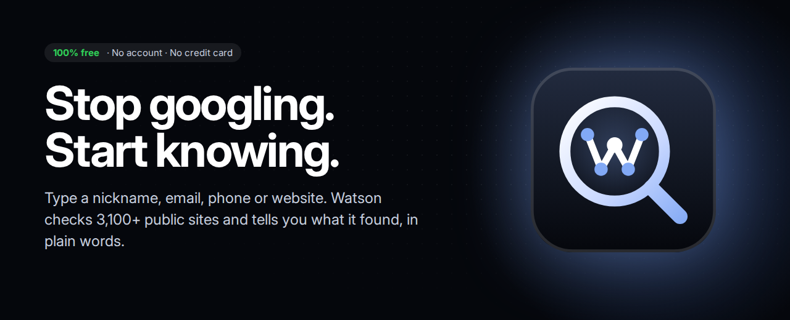
</p>

<p align="center">
  <a href="https://github.com/footprintsntrails/watson/releases/latest"></a>
  
  
  
</p>

---

## You're about to do business with someone. Do you actually know who they are?

Your new supplier. The guy selling you a car. The "recruiter" in your inbox. The account that keeps showing up in your comments.

The answer is already out there, scattered across **3,100+ public sites**. Finding it by hand takes a weekend, a dozen browser tabs and the patience of a detective.

**Watson takes one field and about 30 seconds. And it costs nothing.**

<p align="center">
  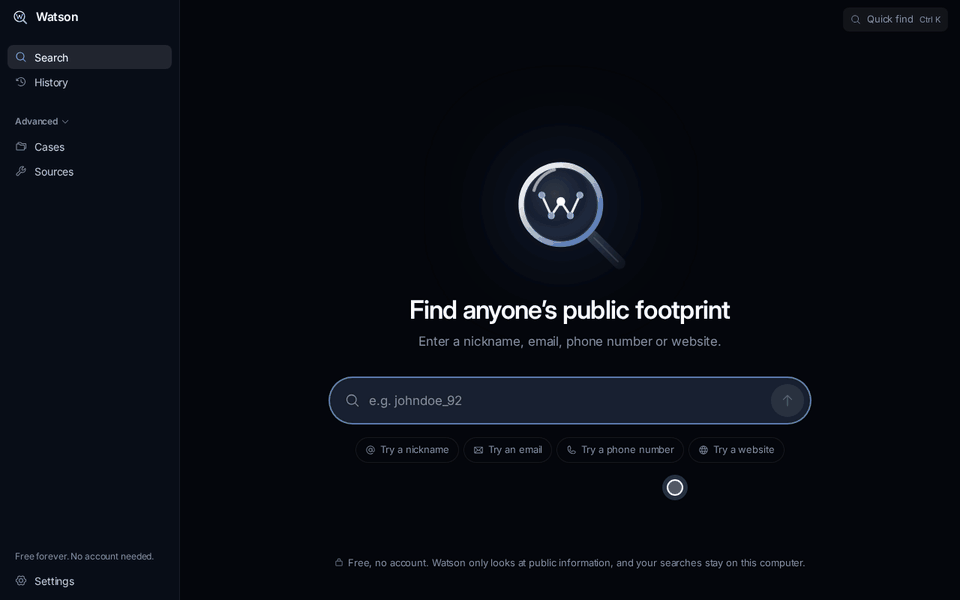
</p>

> [!IMPORTANT]
> **This build is a design prototype.** Every screen is real and clickable, but the results are demo data: Watson does not search the internet yet. It shows exactly what the finished app will look and feel like.

---

## Why Watson

|  | Doing it by hand | Command-line OSINT tools | **Watson** |
| --- | :---: | :---: | :---: |
| Time to first answer | Hours | Minutes, after setup | **Seconds** |
| Skills you need | Patience | Terminal, Python, API keys | **None** |
| Sites checked | As many as you can stand | Depends on the tool | **3,100+** |
| Tells you what it means | No | No | **Yes, in plain words** |
| Same person or same name? | You guess | You guess | **Watson tells you** |
| Report you can send | Copy and paste | Raw JSON | **One-click PDF** |
| Price | Your weekend | Paid API keys add up | **$0. Forever.** |
| Account | n/a | Sign-ups for every API | **None** |

**One field.** Nickname, email, phone or website. Watson works out which one you typed.<br>
**One answer.** Not a wall of links. A short summary you can actually read.<br>
**One click to share.** Save it as a PDF and send it to whoever needs to know.<br>
**Zero dollars.** No trial, no "pro" tier, no credit card.

---

## 100% free. Seriously.

> [!TIP]
> **Watson is completely free.** No subscription, no trial that runs out, no features held back for a paid plan.
>
> **There are no accounts.** No sign-up, no email, no password. Download, open, search.

---

## Install in 2 minutes

No setup wizard, no account, no admin rights. Download one file and open it.

### 1. Download

Go to **[Releases](https://github.com/footprintsntrails/watson/releases/latest)** and click **`Watson-0.1.0-portable.exe`**.

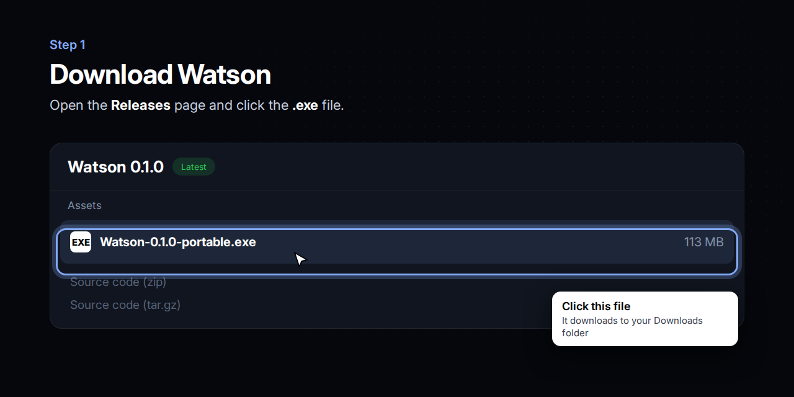

### 2. Open it

Double-click the file you downloaded. If Windows shows a blue warning, click **More info**, then **Run anyway**. You only do this once.

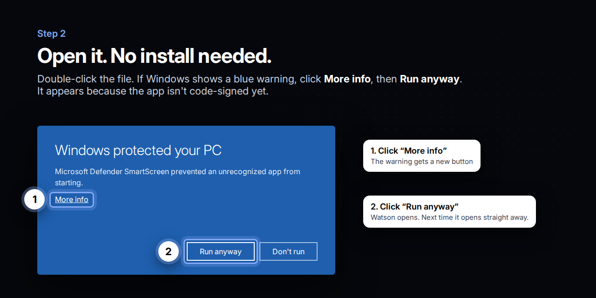

<details>
<summary><b>Why does Windows warn me?</b></summary>
<br>
Windows shows this screen for any new app that hasn't paid for a code-signing certificate yet. It does not mean the file is harmful. Once Watson is signed, the warning goes away.
</details>

### 3. Search

Type what you know and press **Enter**.

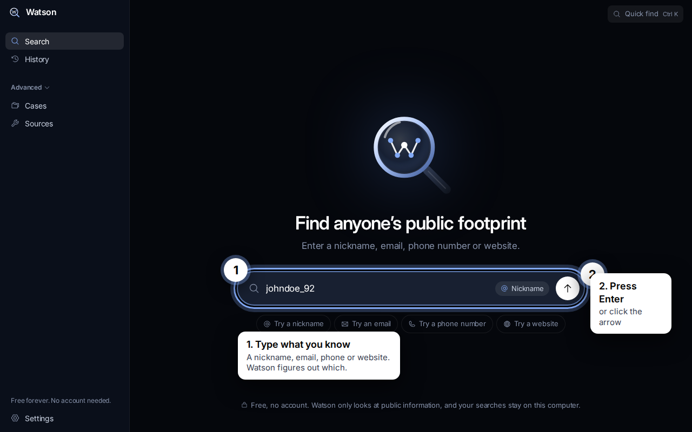

### 4. Read the answer

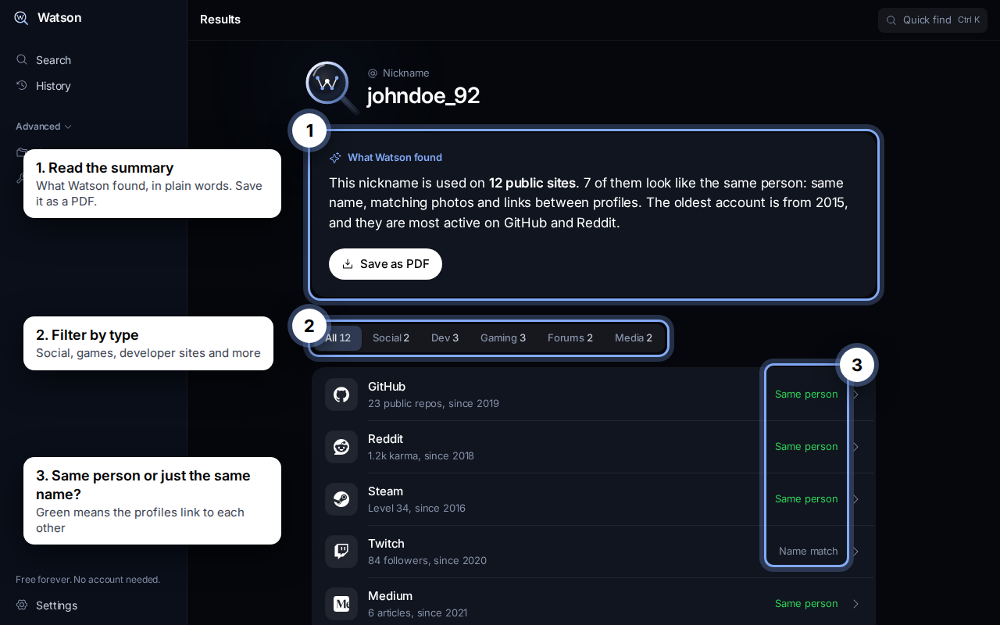

That's it. There is nothing else to learn.

---

## See it in action

### Filter in one click, come back any time

Narrow results to social networks, games, developer sites and more. Every search is saved in **History**, so you never lose a lead.

<p align="center">
  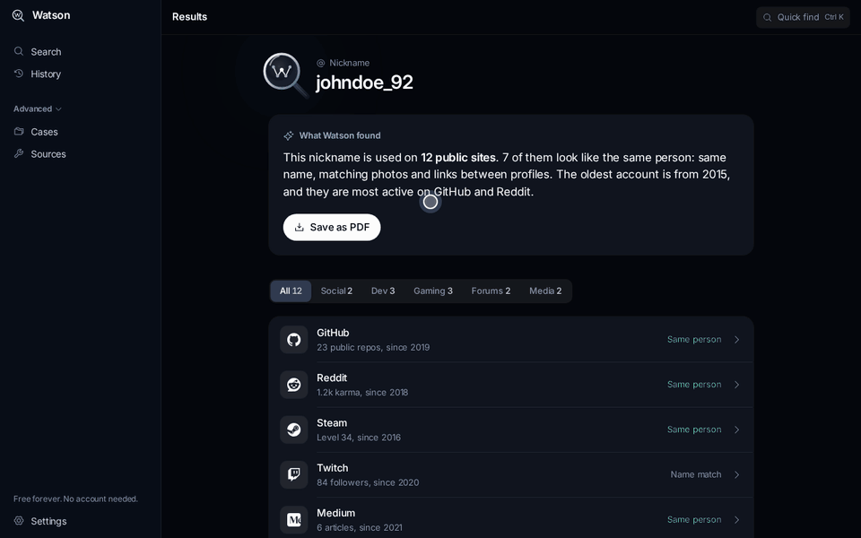
</p>

### Follow the trail

For bigger jobs, **Cases** connect everything Watson found into one map. Click any point to see what it is, why it matters and where the proof came from.

<p align="center">
  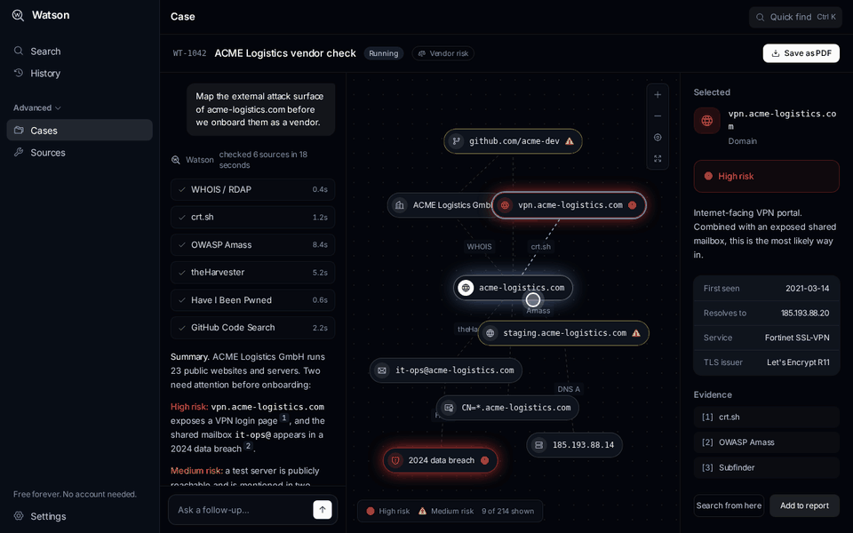
</p>

---

## Every screen

| | |
| :---: | :---: |
| 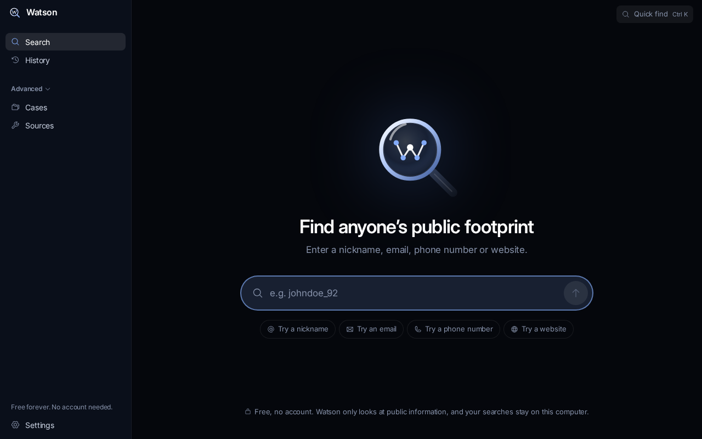<br>**Search.** One field, that's all. | 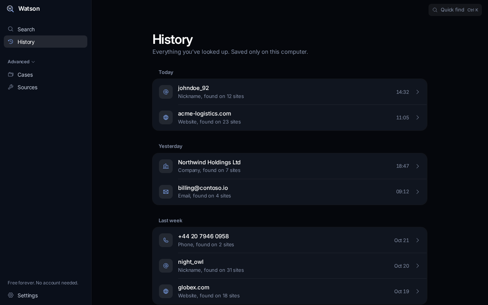<br>**History.** Every search you've made. |
| 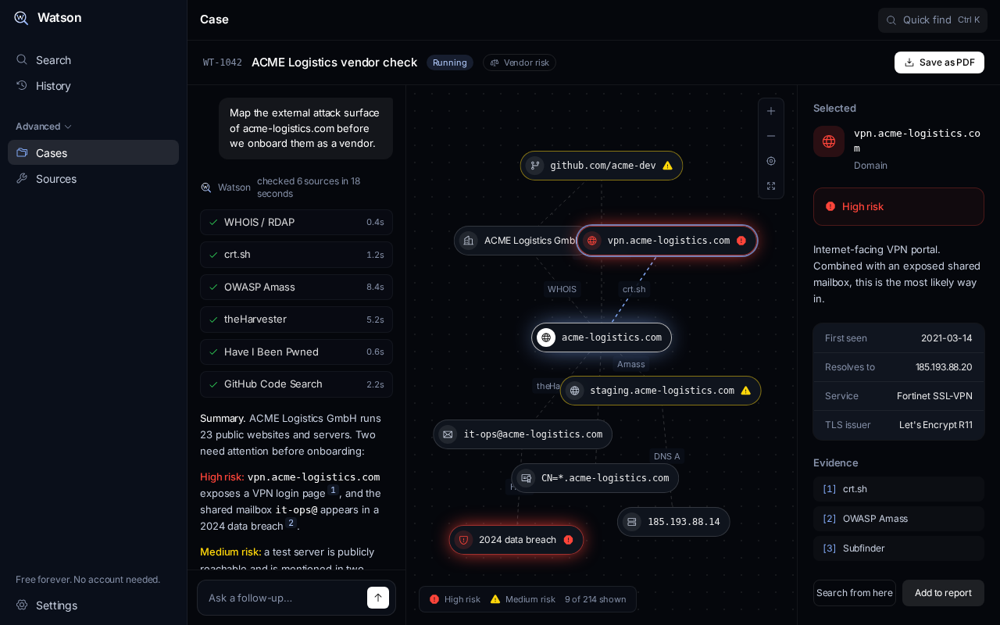<br>**Cases.** The full map, for when it gets serious. | 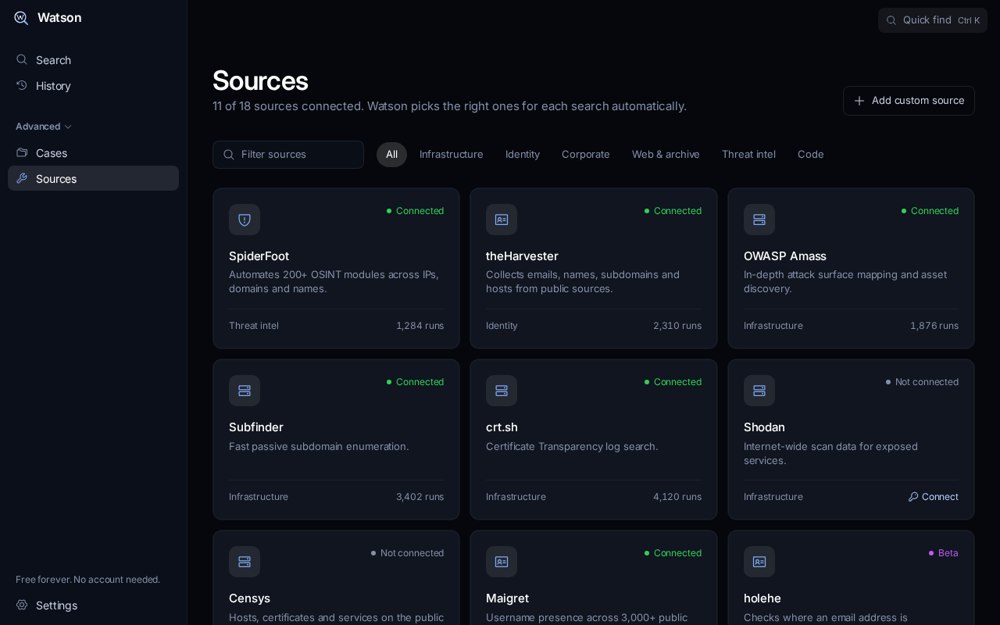<br>**Sources.** The open-source tools working for you. |

---

## Questions

<details>
<summary><b>How much does it cost?</b></summary>
<br>
Nothing. Watson is free, with every feature included. There is no paid version.
</details>

<details>
<summary><b>Do I need an account?</b></summary>
<br>
No. There is no sign-up and no login. Your search history is saved only on your own computer.
</details>

<details>
<summary><b>Is this legal?</b></summary>
<br>
Watson only looks at information that is already public: things anyone could find with a browser and enough time. It doesn't hack, log in as anyone or buy leaked data. How you use what you find is up to you, so follow the law where you live.
</details>

<details>
<summary><b>Does it work on Mac?</b></summary>
<br>
Not as a ready-made download yet. Developers can run it on a Mac from source, see below.
</details>

<details>
<summary><b>Do I need to install anything else?</b></summary>
<br>
No. The .exe has everything inside. Delete the file and it's gone.
</details>

<details>
<summary><b>The download link says 404</b></summary>
<br>
This repository is private. Ask the owner to add your GitHub account as a collaborator, then sign in and open the link again.
</details>

<details>
<summary><b>What do "Same person" and "Name match" mean?</b></summary>
<br>
<b>Same person</b> (green): the profiles link to each other or share photos and details, so they almost certainly belong to one person.<br>
<b>Name match</b> (grey): only the nickname is the same. It could be someone else.
</details>

---

## Use it responsibly

Watson is built for checking who you're dealing with: vendors, partners, sellers, job offers and your own online footprint. Don't use it to stalk, harass or threaten anyone.

---

## For developers

<details>
<summary><b>Run from source, build the .exe, project layout</b></summary>

### Requirements

[Node.js](https://nodejs.org) 22 or newer.

### Run in the browser

```bash
npm install
npm run dev
```

Then open http://localhost:5173/app.

### Run as a desktop app

```bash
npm run app
```

### Build the Windows .exe

```bash
npm run dist:win
```

The file lands in `release/Watson-0.1.0-portable.exe`. Building on Linux works without Wine, but then the .exe keeps the default Electron file icon. Build on Windows to embed the Watson icon.

### Stack

Vite, React 19, TypeScript, Tailwind CSS 4, Electron. Icons: [Phosphor](https://phosphoricons.com) and [Simple Icons](https://simpleicons.org).

### Where things are

| Path | What's there |
| --- | --- |
| `src/pages/app/` | App screens: Search, Results, History, Case, Sources |
| `src/components/` | Logo, glass lens, connections map, brand icons |
| `src/data/mock.ts` | All demo data. Replace with real API calls here. |
| `src/index.css` | Colors, fonts and other design tokens |
| `electron/main.cjs` | Desktop window |
| `DESIGN.md` | Design rules: colors, type, icons, voice |

</details>

---

<p align="center">
  <br>
  <sub>Watson. You see. Watson observes.</sub>
</p>
